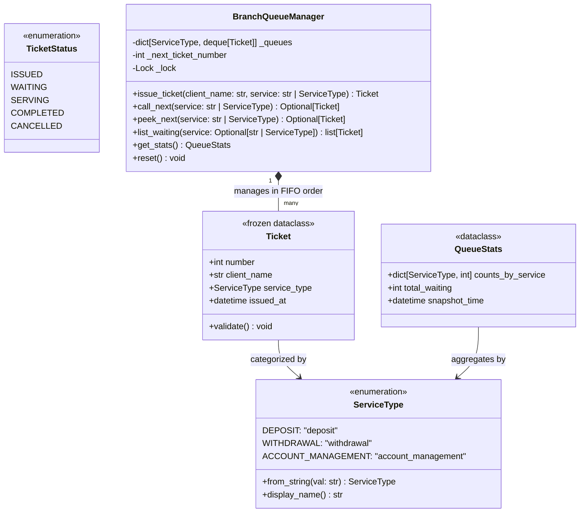
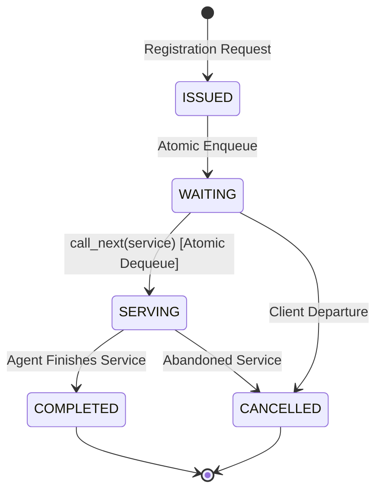

# Phase 1 Data Model: Banco Meridional Queue Manager

**Feature Branch**: `001-branch-queue-manager`  
**Date**: 2026-10-27  
**Status**: Complete  

---

## 1. Domain Entities & Value Objects



---

## 2. Entity Specifications

### 2.1 `ServiceType` (Enum)

Defines the explicit banking service categories supported by the branch.

- **Values**:
  - `DEPOSIT = "deposit"`
  - `WITHDRAWAL = "withdrawal"`
  - `ACCOUNT_MANAGEMENT = "account_management"`
- **Validation Rules**:
  - String inputs must be normalized (stripped of surrounding whitespace, converted to lowercase, and underscores or spaces normalized).
  - Unrecognized strings raise `InvalidServiceTypeError` with a descriptive message listing the valid options.
- **Methods**:
  - `from_string(value: str) -> ServiceType`: Factory method handling normalization.
  - `display_name() -> str`: Human-readable label (e.g. `"Deposit"`, `"Withdrawal"`, `"Account Management"`).

---

### 2.2 `TicketStatus` (Enum)

Defines the deterministic lifecycle states of a customer ticket.

- **Values**:
  - `ISSUED`: Created at reception/kiosk.
  - `WAITING`: Enqueued in the service-specific waiting line.
  - `SERVING`: Dispatched to an active counter/agent.
  - `COMPLETED`: Service transaction successfully concluded.
  - `CANCELLED`: Client left or cancelled request before or during service.

---

### 2.3 `Ticket` (Frozen Dataclass)

An immutable domain record representing a client's position and request.

| Field | Type | Validation / Constraints | Description |
| :--- | :--- | :--- | :--- |
| `number` | `int` | Monotonically positive integer ($\ge 1$). Immutable. | Globally unique sequence number assigned at branch reception. |
| `client_name` | `str` | Non-empty string. Stripped of whitespace. Cannot be empty or purely whitespace. | Client's full or formal name. |
| `service_type` | `ServiceType` | Must be an instance of `ServiceType`. | Banking operation requested by the client. |
| `issued_at` | `datetime` | Valid timezone-aware or branch local `datetime`. Immutable. | Exact moment ticket was recorded. |

#### Invariants & Validation Rules
1. `number > 0`: Ticket sequence numbers always begin at 1 and advance sequentially.
2. `len(client_name.strip()) > 0`: Blank client names are strictly rejected; whitespace is automatically trimmed.
3. Immutability: Once constructed, attribute modification raises `FrozenInstanceError`.

---

### 2.4 `QueueStats` (Dataclass)

An immutable snapshot of active queue metrics across the branch.

| Field | Type | Description |
| :--- | :--- | :--- |
| `counts_by_service` | `dict[ServiceType, int]` | Active waiting count per service type ($\ge 0$). |
| `total_waiting` | `int` | Sum of all active waiting clients across all categories. |
| `snapshot_time` | `datetime` | Timestamp when statistics were computed. |

---

### 2.5 `BranchQueueManager` (Domain Service Coordinator)

The central operational coordinator managing separate FIFO lines, sequence numbers, and thread synchronization.

#### Internal State
- `_queues: dict[ServiceType, deque[Ticket]]`: Isolated FIFO queues for each defined `ServiceType`.
- `_next_ticket_number: int`: Monotonic counter initialized to 1.
- `_lock: threading.Lock`: Mutual exclusion lock guaranteeing atomic ticket generation, dispatch, and safe parallel access.

#### Core Operations & Complexity Guarantees

| Operation | Complexity | Description | Side Effects |
| :--- | :---: | :--- | :--- |
| `issue_ticket(client_name, service)` | $O(1)$ | Validates inputs, claims next sequence number, appends ticket to target service deque. | Increments sequence counter; enqueues ticket. |
| `call_next(service)` | $O(1)$ | Removes and returns the oldest waiting client from the service deque. Returns `None` if empty. | Mutates queue state (dequeues ticket). |
| `peek_next(service)` | $O(1)$ | Returns the oldest waiting client without removal. Returns `None` if empty. | **None** (Idempotent, non-mutating). |
| `list_waiting(service=None)` | $O(K)$ | Returns an immutable copy/list of waiting tickets (optionally filtered by service). | **None** (Idempotent, non-mutating). |
| `get_stats()` | $O(1)$ | Calculates queue length for all 3 fixed services and total sum. | **None** (Idempotent, non-mutating). |
| `reset()` | $O(1)$ | Clears all queues and resets ticket counter to 1 (used for branch day opening or test setups). | Clears in-memory queues and resets counter. |

---

## 3. State Transition Matrix



### Transition Invariants
- `ISSUED -> WAITING`: Occurs atomically during `issue_ticket()`.
- `WAITING -> SERVING`: Occurs atomically during `call_next()`. Dequeue must precede return to ensure that no two agents can claim the same ticket under race conditions.
- `peek_next()` and `list_waiting()` never trigger state transitions.

---

## 4. Error Hierarchy

```text
BranchQueueError (Base exception for all queue operations)
├── ValidationError
│   ├── InvalidServiceTypeError (Provided service string cannot be parsed into ServiceType)
│   └── EmptyClientNameError (Client name was empty or whitespace)
└── QueueOperationError
    └── (Used if unexpected operational errors occur)
```
