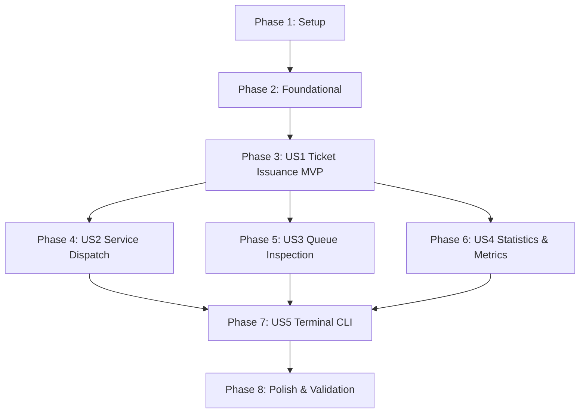

# Tasks: Banco Meridional Queue Manager

**Input**: Design documents from `specs/001-branch-queue-manager/` (`spec.md`, `plan.md`, `data-model.md`, `research.md`, `contracts/`, `quickstart.md`)  
**Prerequisites**: [plan.md](file:///j:/GitHub/branch-queue/specs/001-branch-queue-manager/plan.md), [spec.md](file:///j:/GitHub/branch-queue/specs/001-branch-queue-manager/spec.md), [data-model.md](file:///j:/GitHub/branch-queue/specs/001-branch-queue-manager/data-model.md), [contracts/](file:///j:/GitHub/branch-queue/specs/001-branch-queue-manager/contracts/), [Constitution](file:///j:/GitHub/branch-queue/.specify/memory/constitution.md)

---

## Format: `- [ ] [ID] [P?] [Story?] Description with file path`

- **[P]**: Can run in parallel (different files, independent dependencies)
- **[Story]**: User story identifier ([US1], [US2], [US3], [US4], [US5])
- All tasks reference explicit file paths

---

## Phase 1: Setup (Shared Infrastructure)

**Purpose**: Initialize project folder hierarchy, Python packaging, and shared test infrastructure.

- [X] T001 Create project directories and package init files in src/models/, src/services/, src/exceptions/, src/cli/, tests/unit/, and tests/integration/
- [X] T002 [P] Configure shared pytest fixtures and mock time provider in tests/conftest.py

---

## Phase 2: Foundational (Blocking Prerequisites)

**Purpose**: Core domain types, exceptions, and base coordinator structure that MUST be complete before ANY user story can be implemented.

**⚠️ CRITICAL**: No user story implementation can begin until this foundational phase is complete.

- [X] T003 [P] Implement domain exception hierarchy in src/exceptions/errors.py
- [X] T004 [P] Implement ServiceType enum and normalization logic in src/models/service_type.py
- [X] T005 Implement BranchQueueManager coordinator skeleton with isolated deques, lock, and reset in src/services/queue_manager.py

**Checkpoint**: Foundation ready — user story implementations can now begin.

---

## Phase 3: User Story 1 - Client Arrival & Sequential Ticket Issuance (Priority: P1) 🎯 MVP

**Goal**: Register arriving clients with validated names and service types, issuing monotonic, gapless sequential tickets starting at #1 with immutable timestamps.

**Independent Test**: Issue tickets alternating across `deposit`, `withdrawal`, and `account_management`. Verify ticket numbers increment strictly from 1 upwards without gaps or resets between categories, and that invalid inputs raise descriptive errors without advancing the global counter.

### Tests for User Story 1

> **NOTE: Write these tests FIRST, ensure they FAIL before implementation**

- [X] T006 [P] [US1] Write unit tests for Ticket model immutability and validation in tests/unit/test_models.py
- [X] T007 [P] [US1] Write unit tests for monotonic sequential ticket issuance and validation in tests/unit/test_queue_manager.py

### Implementation for User Story 1

- [X] T008 [P] [US1] Implement Ticket frozen dataclass and TicketStatus enum in src/models/ticket.py
- [X] T009 [US1] Implement issue_ticket() with atomic post-validation counter increment and FIFO enqueueing in src/services/queue_manager.py

**Checkpoint**: User Story 1 functional and independently testable (MVP milestone).

---

## Phase 4: User Story 2 - Dedicated Service Agent Dispatch (Priority: P1)

**Goal**: Enable tellers and service agents to call the longest-waiting client for their specific service category, strictly adhering to FIFO discipline without cross-queue interference.

**Independent Test**: Enqueue multiple clients across `deposit`, `withdrawal`, and `account_management`. Call next for one category and verify only the earliest arrival for that specific category is dequeued, other queues remain untouched, and calling an empty queue returns `None` safely.

### Tests for User Story 2

> **NOTE: Write these tests FIRST, ensure they FAIL before implementation**

- [X] T010 [P] [US2] Write unit tests for call_next() FIFO dispatch, isolated queues, and empty queue handling in tests/unit/test_queue_manager.py
- [X] T011 [P] [US2] Write integration tests for multi-threaded dispatch race condition prevention in tests/integration/test_concurrency.py

### Implementation for User Story 2

- [X] T012 [US2] Implement call_next() with thread-safe atomic dequeue and empty queue safety in src/services/queue_manager.py

**Checkpoint**: User Stories 1 AND 2 functional; automated dispatch verified against race conditions.

---

## Phase 5: User Story 3 - Queue Oversight & Non-Mutating Inspection (Priority: P2)

**Goal**: Provide supervisors and agents with side-effect-free peek and full queue listing capabilities to inspect waiting clients without disturbing line ordering.

**Independent Test**: Enqueue tickets, call `peek_next()` and `list_waiting()`, and verify queue depth, ordering, and ticket sequence remain 100% identical before and after inspection. Verify peeking an empty queue returns `None` without errors.

### Tests for User Story 3

> **NOTE: Write these tests FIRST, ensure they FAIL before implementation**

- [X] T013 [P] [US3] Write unit tests for non-mutating peek_next() and list_waiting() in tests/unit/test_queue_manager.py

### Implementation for User Story 3

- [X] T014 [US3] Implement peek_next() for side-effect-free queue inspection in src/services/queue_manager.py
- [X] T015 [US3] Implement list_waiting() returning defensive copies grouped by service in src/services/queue_manager.py

**Checkpoint**: User Stories 1, 2, and 3 fully functional and verified non-mutating.

---

## Phase 6: User Story 4 - Branch Real-Time Statistics & Load Monitoring (Priority: P2)

**Goal**: Compute real-time waiting metrics per service category and aggregate branch total depth instantly in $O(1)$ time without queue mutations.

**Independent Test**: Query queue statistics across empty, partially populated, and post-dispatch states; verify exact counts per service category and that `total_waiting` matches the sum of individual service queues.

### Tests for User Story 4

> **NOTE: Write these tests FIRST, ensure they FAIL before implementation**

- [X] T016 [P] [US4] Write unit tests for QueueStats snapshot and get_stats() metrics in tests/unit/test_queue_manager.py

### Implementation for User Story 4

- [X] T017 [P] [US4] Implement QueueStats dataclass in src/models/stats.py
- [X] T018 [US4] Implement get_stats() computing instantaneous queue depth metrics in src/services/queue_manager.py

**Checkpoint**: Operational metrics engine complete with instantaneous $O(1)$ calculations.

---

## Phase 7: User Story 5 - Interactive Terminal Operations Interface (Priority: P3)

**Goal**: Deliver a keyboard-driven terminal console menu enabling branch staff to issue tickets, dispatch clients, inspect queues, view statistics, and exit cleanly with robust input validation.

**Independent Test**: Navigate all menu options (1 through 6), provide valid and invalid inputs, verify clear error messages for invalid choices or blank names, and confirm clean termination on exit (option 6, Ctrl+C, Ctrl+D).

### Tests for User Story 5

> **NOTE: Write these tests FIRST, ensure they FAIL before implementation**

- [X] T019 [P] [US5] Write integration tests for CLI menu options, input guards, and exit handling in tests/integration/test_terminal_cli.py

### Implementation for User Story 5

- [X] T020 [P] [US5] Implement CLI formatting, menu display, and input validation helpers in src/cli/terminal.py
- [X] T021 [US5] Implement interactive terminal main loop with options 1-6 and error guards in src/cli/terminal.py
- [X] T022 [US5] Create application entrypoint script in main.py

**Checkpoint**: End-to-end interactive terminal application fully functional and guarded against crashes.

---

## Phase 8: Polish & Cross-Cutting Concerns

**Purpose**: Execute end-to-end scenario validations, documentation, and quality gates across all user stories.

- [X] T023 [P] Add root documentation and execution instructions in README.md
- [X] T024 Validate end-to-end scenarios per specs/001-branch-queue-manager/quickstart.md
- [X] T025 Execute complete test suite and verify code quality across tests/

---

## Dependencies & Execution Order

### Phase Dependencies

- **Setup (Phase 1)**: No dependencies — can start immediately.
- **Foundational (Phase 2)**: Depends on Setup (Phase 1) — **BLOCKS all user stories**.
- **User Story 1 (Phase 3)**: Depends on Foundational (Phase 2). Establishes domain models and sequential ticket issuance (MVP).
- **User Story 2 (Phase 4)**: Depends on Foundational (Phase 2) and User Story 1 (needs tickets enqueued to dispatch).
- **User Story 3 (Phase 5)**: Depends on Foundational (Phase 2) and User Story 1 (needs tickets to inspect).
- **User Story 4 (Phase 6)**: Depends on Foundational (Phase 2) and User Story 1 (needs ticket counts to aggregate).
- **User Story 5 (Phase 7)**: Depends on Phases 3, 4, 5, and 6 (exposes all domain capabilities in CLI).
- **Polish (Phase 8)**: Depends on all user story phases being complete.



### User Story Dependencies

- **User Story 1 (P1)**: Can start immediately after Phase 2 (Foundational). Core MVP dependency for all subsequent stories.
- **User Story 2 (P1)**: Can proceed once US1 ticket generation is available; dispatches tickets from isolated deques.
- **User Story 3 (P2)**: Can proceed in parallel with or after US2; reads tickets without mutating state.
- **User Story 4 (P2)**: Can proceed in parallel with US2/US3; calculates queue depth metrics.
- **User Story 5 (P3)**: Integrates all preceding stories into the interactive terminal interface.

### Parallel Opportunities

- **Phase 1 Setup**: `T002` can proceed in parallel with `T001`.
- **Phase 2 Foundational**: `T003` (`errors.py`) and `T004` (`service_type.py`) can be built in parallel.
- **Phase 3 (US1)**: `T006` (model tests), `T007` (manager tests), and `T008` (`Ticket` model) can be authored in parallel.
- **Phase 4 (US2)**: `T010` (unit tests) and `T011` (concurrency tests) can run in parallel before `T012`.
- **Phase 5 & 6 (US3 & US4)**: Can be developed concurrently by separate engineers once US1 is complete.
- **Phase 7 (US5)**: `T019` (integration tests) and `T020` (CLI formatters) can run in parallel before `T021`.

---

## Parallel Execution Examples

### User Story 1 (Parallel Task Group)
```bash
# Launch US1 tests and models together:
Task: "Write unit tests for Ticket model immutability and validation in tests/unit/test_models.py" (T006)
Task: "Write unit tests for monotonic sequential ticket issuance and validation in tests/unit/test_queue_manager.py" (T007)
Task: "Implement Ticket frozen dataclass and TicketStatus enum in src/models/ticket.py" (T008)
```

### User Story 2 (Parallel Task Group)
```bash
# Launch US2 unit tests and concurrency race condition tests together:
Task: "Write unit tests for call_next() FIFO dispatch, isolated queues, and empty queue handling in tests/unit/test_queue_manager.py" (T010)
Task: "Write integration tests for multi-threaded dispatch race condition prevention in tests/integration/test_concurrency.py" (T011)
```

### User Story 3 & 4 (Cross-Story Parallel Execution)
```bash
# After US1 completion, US3 and US4 can proceed simultaneously:
Task: "Write unit tests for non-mutating peek_next() and list_waiting() in tests/unit/test_queue_manager.py" (T013)
Task: "Implement QueueStats dataclass in src/models/stats.py" (T017)
```

---

## Implementation Strategy

### MVP First (User Story 1 Only)

1. Complete **Phase 1: Setup** (`T001`, `T002`).
2. Complete **Phase 2: Foundational** (`T003`, `T004`, `T005`).
3. Complete **Phase 3: User Story 1** (`T006`, `T007`, `T008`, `T009`).
4. **STOP and VALIDATE**: Run `python -m pytest tests/unit/test_models.py tests/unit/test_queue_manager.py`. Verify tickets issue sequentially (#1, #2, #3...) with immutable timestamps and robust input validation.
5. Deliver MVP milestone.

### Incremental Delivery

1. **Increment 1 (MVP)**: Setup + Foundation + Ticket Issuance (`US1`).
2. **Increment 2**: Add FIFO Dispatch (`US2`) with thread-safe atomic dequeue.
3. **Increment 3**: Add Inspection (`US3`) with side-effect-free peek and list.
4. **Increment 4**: Add Analytics (`US4`) with instant $O(1)$ stats snapshot.
5. **Increment 5**: Add CLI (`US5`) terminal console loop and `main.py` entrypoint.
6. **Increment 6**: End-to-end validation against `quickstart.md` scenarios and polish.
