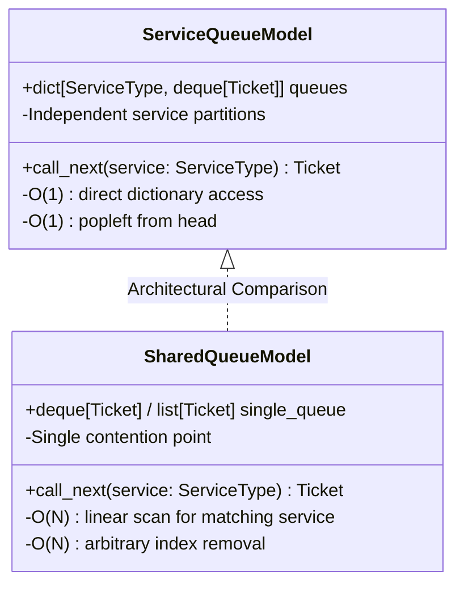
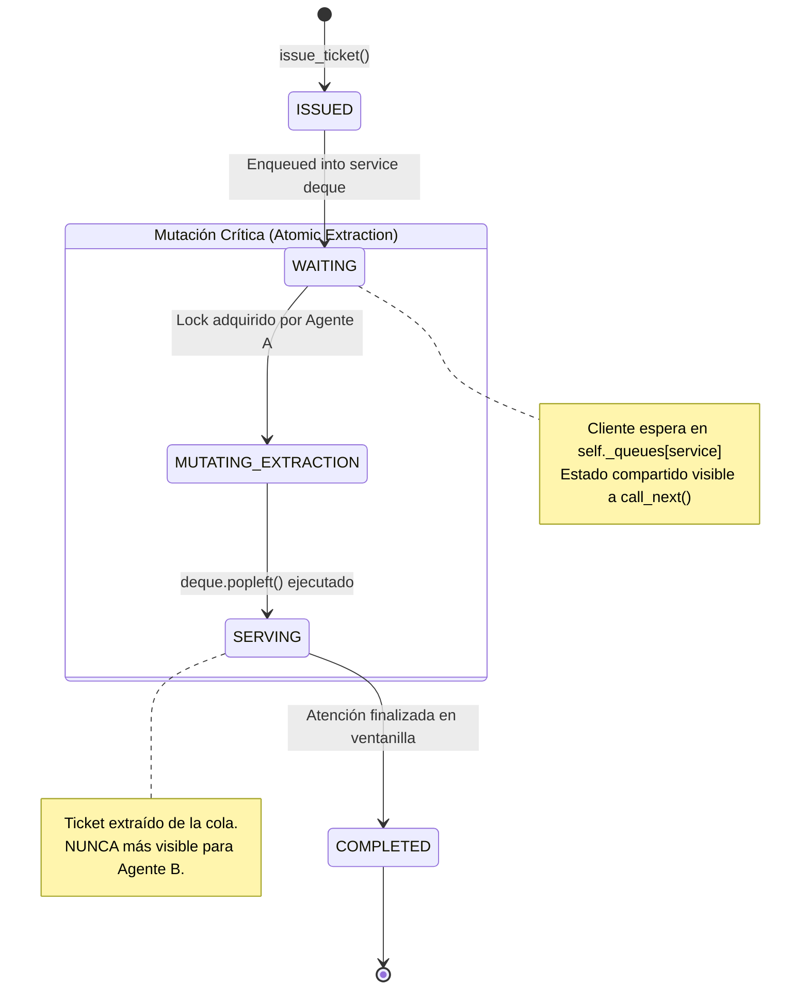

# Data Model & Conceptual Architecture: Design Notes (`DESIGN.md`)

**Feature Branch**: `002-design-notes`  
**Date**: 2026-11-08  
**Status**: Completed  

---

## 1. Conceptual Entities

### 1.1 Documento de Diseño (`DESIGN.md`)
The root architectural documentation artifact.

| Field / Attribute | Type | Description | Validation Rule |
| :--- | :--- | :--- | :--- |
| `path` | String | Location within repository (`./DESIGN.md`) | MUST reside at the exact project root |
| `language` | String | Written human language (`es` / Spanish) | MUST be 100% Spanish text |
| `format` | String | CommonMark / GitHub Flavored Markdown | Valid markdown headings and syntax |
| `sections` | List[Section] | Required architectural topics | MUST cover Efficiency, Concurrency, and State Mutation |

### 1.2 Estructura de Cola por Servicio (`ServiceQueue`) vs. Cola Compartida (`SharedQueue`)
The comparative architectural models analyzed in the design notes.



### 1.3 Operación de Despacho Concurrente (`call_next`)
The critical coordination method analyzed for race condition mitigation.

| Component | Responsibility | Concurrency Role |
| :--- | :--- | :--- |
| `service_type` | Target service filter | Identifies target queue |
| `_lock` (`threading.Lock`) | Mutual exclusion | Guarantees only one thread executes dispatch logic at any instant |
| `_queues[service_type]` | Bounded FIFO queue | Source collection for tickets |
| `critical_section` | Atomic execution block | Encloses validation, extraction, and error handling |

---

## 2. State Transition Model: Ticket Dispatch Lifecycle

The design notes explain the ticket state transitions and identify the exact sequence of state changes during `call_next`.



### State Mutation Ordering Rules

1. **Rule 1 (Atomic Extraction First)**: The ticket removal (`popleft()`) from the active waiting queue MUST occur inside the mutual exclusion critical section before the ticket reference is delivered to the service counter.
2. **Rule 2 (Single Ownership)**: Once removed from `self._queues[service]`, the ticket instance is exclusively owned by the calling counter. Concurrent callers cannot read or reference it.
3. **Rule 3 (Fail-Fast on Empty)**: If `len(queue) == 0` upon acquiring the lock, `EmptyQueueError` is raised without state modification, preventing phantom dispatches.

---

## 3. Concurrency Sequence: Dual Agent Collision (`call_next`)

### Scenario A: Unsynchronized Race Condition (Failure Mode)

```text
Time    Agent A (Counter 1)                 Agent B (Counter 2)
 |
 t0     call_next(DEPOSIT)                  call_next(DEPOSIT)
 |
 t1     Read queue head -> Ticket #10       .
 |                                          Read queue head -> Ticket #10 (TOCTOU hazard)
 t2     .                                   .
 |
 t3     Summon Ticket #10 to Counter 1      .
 |                                          Summon Ticket #10 to Counter 2
 t4     .
 v      💥 FAILURE: Both agents summoned Ticket #10 simultaneously!
```

### Scenario B: Synchronized Critical Section with Early State Mutation (Correct Design)

```text
Time    Agent A (Counter 1)                 Agent B (Counter 2)
 |
 t0     call_next(DEPOSIT)                  call_next(DEPOSIT)
 |
 t1     [Acquires Lock]                     [Blocks waiting for Lock]
 |
 t2     MUTATION 1: q.popleft() -> #10      .
 |      State mutated: #10 removed          .
 |
 t3     [Releases Lock & Returns #10]       .
 |                                          [Acquires Lock]
 t4     .                                   MUTATION 2: q.popleft() -> #11
 |                                          State mutated: #11 removed
 t5     Agent A serves Ticket #10           [Releases Lock & Returns #11]
 |                                          Agent B serves Ticket #11
 v      ✅ SUCCESS: Sequential, distinct, safe dispatch!
```

